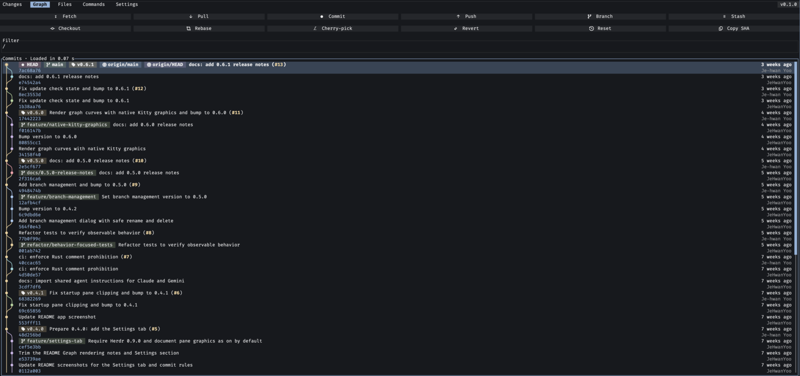
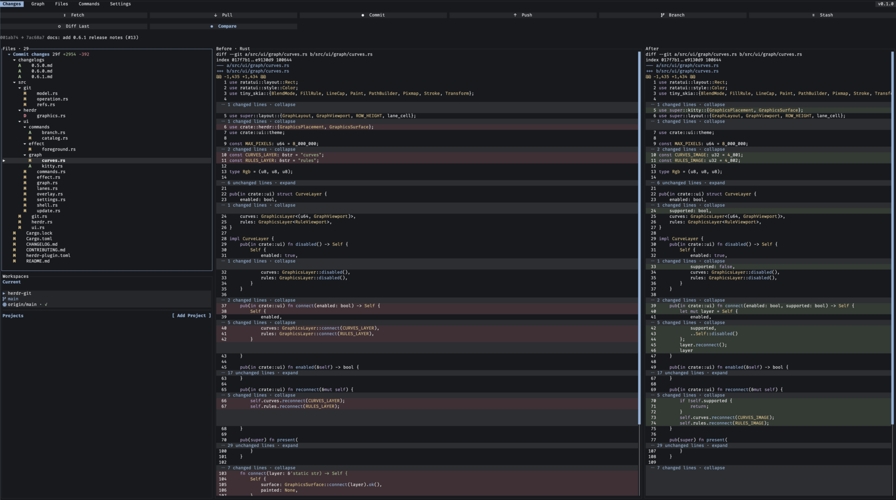
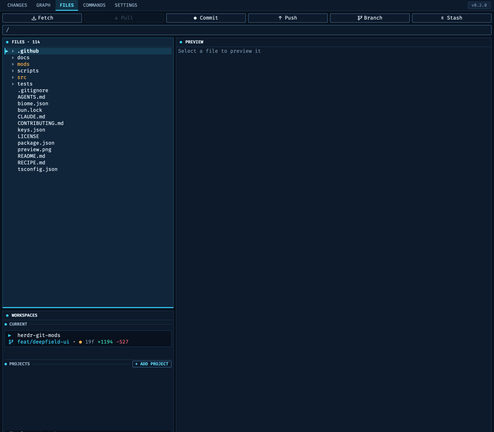
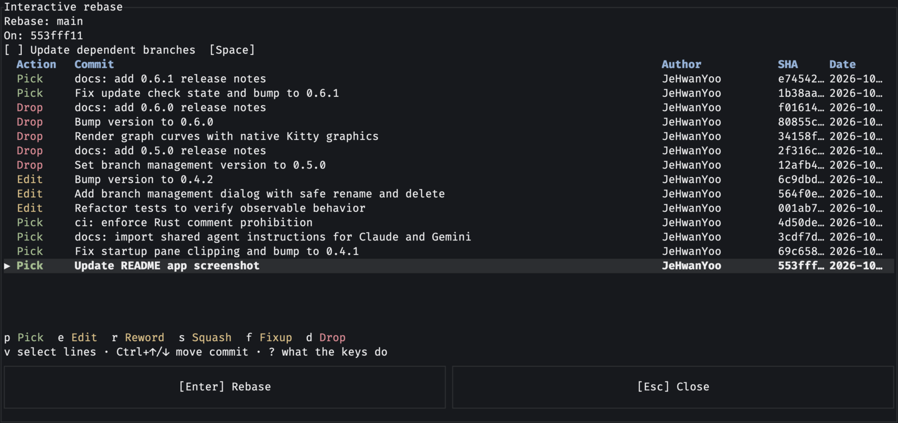
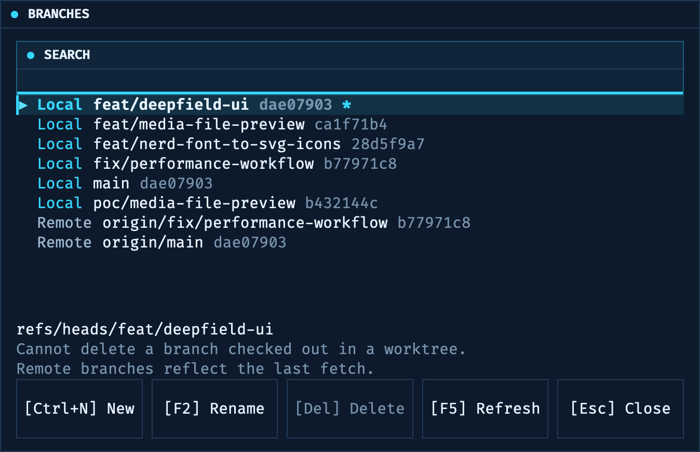
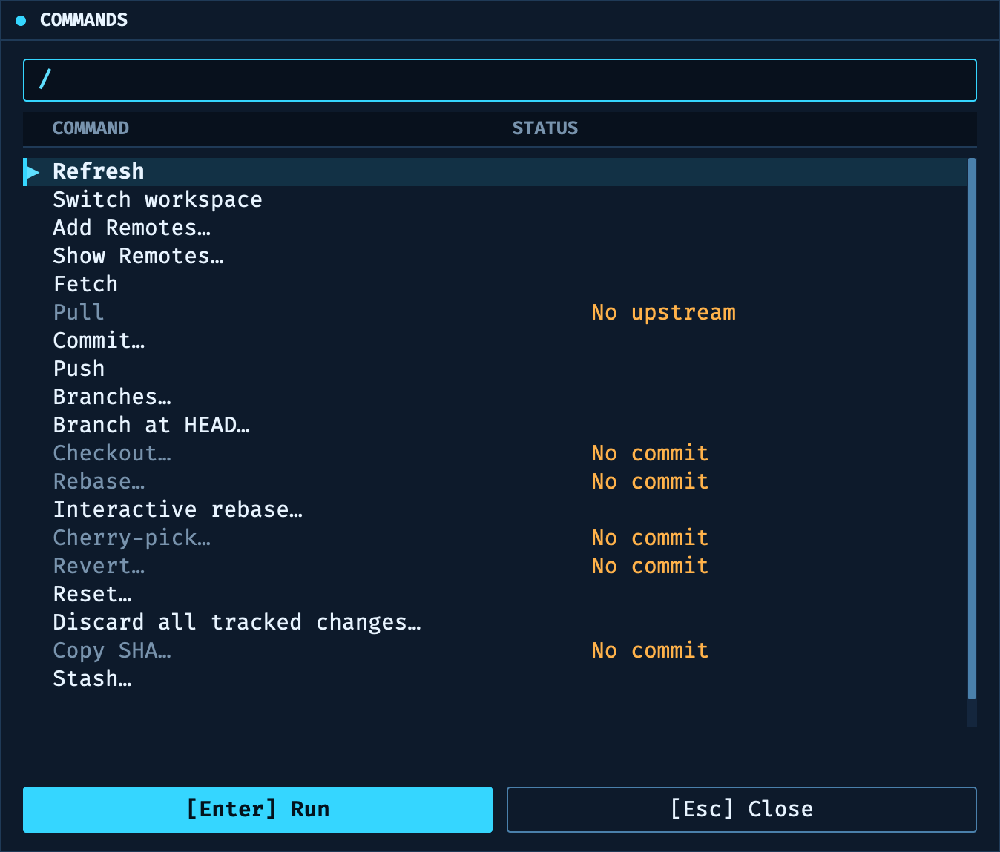

# Herdr Git Mods

Essential Git, in one pane. No extra setup, no overlays covering your Herdr.

A Git client for the [Herdr App](https://herdr.dev), and the next version of the [herdr-git](https://github.com/JeHwanYoo/herdr-git) TUI plugin.

## Principles

- **Blazing fast.** Performance comes first, so every view opens and responds without a wait.
- **Simple and intuitive.** You can find what you need without reading a manual.
- **Made for Git, not agents.** Every feature serves your Git workflow, with no agent features to get in the way.

## Install

Requires the Herdr App 0.1.16 or later and Git.

Tell your agent in Herdr:

```text
Read ~/.config/herdr-app/AGENTS.md, then add this mod: github.com/JeHwanYoo/herdr-git-mods
```

Focus a terminal in a Git repository and press ⌘G to open Git on the right of the tab. Press ⌘G again to close it.

Git checks GitHub Releases for updates while its pane is open. Open **Settings → Versions** to check on demand and install a newer release. Update checks use `curl`.

## Features

<table>
  <tr>
    <td width="33%" align="center"><a href="docs/images/graph.png"></a><br><sub>Commit graph</sub></td>
    <td width="33%" align="center"><a href="docs/images/compare.png"></a><br><sub>Side-by-side compare</sub></td>
    <td width="33%" align="center"><a href="docs/images/files.png"></a><br><sub>Files, blame &amp; line history</sub></td>
  </tr>
  <tr>
    <td width="33%" align="center"><a href="docs/images/interactive-rebase.png"></a><br><sub>Interactive rebase</sub></td>
    <td width="33%" align="center"><a href="docs/images/branches.png"></a><br><sub>Branches</sub></td>
    <td width="33%" align="center"><a href="docs/images/commands.png"></a><br><sub>Command palette</sub></td>
  </tr>
</table>

| Feature                     | What you can do                                                                                                                                    |
| --------------------------- | -------------------------------------------------------------------------------------------------------------------------------------------------- |
| Changes                     | Review changed files, stage or unstage them, and discard tracked changes                                                                           |
| Diffs                       | View changes side by side and compare commits or branches                                                                                          |
| Graph                       | Browse and filter commit history with a lane graph                                                                                                 |
| Files                       | Browse repository files, search file names and contents, and preview files with syntax highlighting, working-tree changes, blame, and line history |
| Blame & line history        | See who changed selected lines and review their history                                                                                            |
| Copy                        | Copy selected code with its file path and line numbers                                                                                             |
| Commit                      | Create or amend a commit                                                                                                                           |
| Remotes                     | Add, view, or remove remotes; fetch, pull, and choose where to push                                                                                |
| Branches & tags             | Find and switch branches, create branches and tags, and rename or delete local branches                                                            |
| Rebase                      | Rebase onto a branch or commit, including interactive rebase                                                                                       |
| Cherry-pick, revert & reset | Apply a commit, undo it, or reset to it                                                                                                            |
| Stash                       | Save uncommitted changes and restore them                                                                                                          |
| Workspaces                  | Switch between repositories, Projects, and worktrees                                                                                               |

## Keyboard shortcuts

Hold `Alt` to see all keyboard shortcuts.

## Development

Install [Bun](https://bun.com), then run:

```sh
bun install
bun run check  # Lint, type check, tests, build, and herdr-app check
bun run link   # Build and install the mod into Herdr
```

## Contributing

[Contribution guide](CONTRIBUTING.md)

## License

[MIT](LICENSE)
