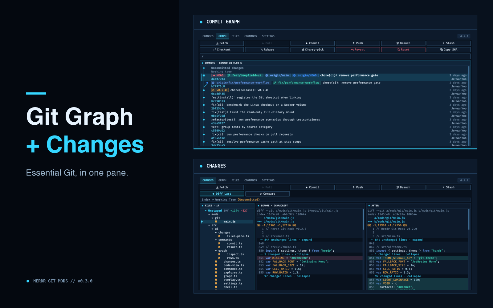

# Herdr Git Mods

A Git client in a full-height pane at the tab's far right, opened and closed with ⌘G, laid out like the herdr-git terminal plugin. Tabs for Changes, Graph, Files, Commands and Settings sit above a toolbar of Fetch, Pull, Commit, Push, Branch and Stash. Changes shows the changed-file tree beside a side-by-side Before/After diff. Graph shows the commit graph with lanes, ref badges and commit details. Files shows the repository tree with a highlighted preview, blame and line history. A Workspaces box switches between the focused terminal's repository, saved Projects and their worktrees. It follows the focused terminal's repository, also on another machine.

## What you see

The whole pane is a terminal-style cell grid in the person's terminal font (`settings().font_family`, `font_size`; JetBrains Mono 14 otherwise). One cell is `font_size × 0.6` wide and one row `font_size × 1.3` tall. Every region is a box with a 1px `border` outline and its title on the top edge; the focused box's outline is `accent`. Colors are theme names only.

- **Header:** tabs `Changes  Graph  Files  Commands  Settings`; the active tab has an `accent` background with bold text. The version sits at the right.
- **Toolbar:** six equal filled buttons on `popover`: `↧ Fetch`, `↓ Pull`, `● Commit`, `↑ Push`, branch glyph `Branch`, `≡ Stash`. A running action shows a spinner and its progress label (`Fetching`, `Pulling`, …).
- **Second toolbar:** on Graph, `Checkout`, `Rebase`, `Cherry-pick`, `Revert`, `Reset`, `Copy SHA`. On Changes, the radios `● Diff Last` / `○ Compare`, then a line like `0d87033 → 8bae164 subject`.
- **Changes:** at 90 columns or wider, three columns with draggable dividers. On the left, `Files · N` over `Workspaces`, 50/50. The tree starts with a section root (`Working changes`, `Commit changes`, `Staged`, `Unstaged`) with counts like `25f +806 -85`, then `▾`/`▸` folders and files with a bold status letter (`A`/`?` `ansi2`, `M` `ansi3`, `D` `ansi1`, `R`/`C` `accent`, `T` `ansi4`, `U` `ansi5`). In the middle `Before · <Language>`, on the right `After`: line numbers, added lines on `ansi2` and removed lines on `ansi1` at low alpha, fold rows `⋯ N unchanged lines · expand` / `⋯ N changed lines · collapse`, and vertical and horizontal scrollbars. Narrower panes stack the three regions 25/37/38.
- **Graph:** a `Filter` box with a `/` prompt. Below it, `Commits · Loaded in 0.05 s`: two rows per commit. The first row has the lane graph in six lane colors (`ansi11`, `ansi14`, `ansi10`, `ansi13`, `ansi9`, `ansi12`), ref badges (HEAD, local, remote, remote HEAD, tag) with glyphs on tinted backgrounds, the subject with `(#123)` in `ansi11`, and the relative date at the right. The second row has the short SHA and the author. Then `[PgDn] Load more`. Underneath, `Workspaces` beside `Commit details`: bold subject, Author, Date, SHA, Parents, Refs, body, and `Changes · N` with status letter, file glyph and path.
- **Files:** `Filter`, then `Files · N` (a tree with `▶` on the selected row) over `Workspaces` on the left, and `Preview` on the right (`Select a file to preview it` until a file is chosen). PNG, JPEG, and WebP images from the local working tree fit the preview panel.
- **Workspaces:** `Current` with the followed folder (`Not a Git repository` in `ansi3` when it isn't one). Then `Projects  [ Add Project ]`, each project as `▸ name · N worktrees`, with rows for the branch, the upstream with `↑ahead ↓behind` or `✓`, and `● 3f +74 -3` when dirty.
- **Status bar:** one row on `raised`: `Branch: <name>` in bold `accent`, `· HEAD <sha8>`, `· Selected: <sha8>` on Graph, `│ <repository path> │`, then the blame of the selected lines or the GitHub identity `Name(email)`, then a spinner with the current progress, then the last error in `ansi1`.
- **Dialogs:** centered boxes. A picker has a `Search` field, rows with `▶`, an optional `Status` column, and `[Enter] Run` / `[Esc] Close` buttons. `Confirm Git operation` shows the branch, the exact Git command, its effect and the command name, with `[Enter] Run` / `[Esc] Cancel`.

## How it behaves

- ⌘G on a tab without Git splits the tab's root to the right with Git, so every existing split stays on the left, and focuses it. ⌘G again closes it, wherever it was moved.
- The pane follows the focused terminal in its tab, including its machine. A Project or worktree chosen in Workspaces stays selected until `Current` is chosen again.
- Local repositories refresh when files change and every 10 seconds (Settings › Background refresh); remote ones every 10 seconds.
- Hold Alt to see every shortcut. Alt+1/2/3 and Alt+, switch tabs. Alt+P opens the command palette, Alt+W Select Workspace, and Alt+O the file filter. Alt+F/L/C/U/B/S run the toolbar actions. On Graph, Alt+A opens commit actions, and Alt+X/R/Y/V/T/H run Checkout, Rebase, Cherry-pick, Revert, Reset and Copy SHA. macOS Option characters (`ƒ`, `π`, …) count as the same keys. Tab cycles the tabs; Esc steps focus back.
- Changes: `s`/`u` stage and unstage the selected file or folder. `v` or dragging selects several files. Hovering a row shows `+`, `-` and `↶` (discard, after confirmation). Diff Last compares the working tree, or HEAD with its parent when the tree is clean. Compare asks for a base and a target. In the diff, `v` or dragging selects lines, `y` copies them with path and line numbers, `h` opens their line history and `b` shows blame.
- Graph: j/k and arrows move, PgDn loads more, Enter shows the commit's changes in Changes, and right-click opens commit actions. Choosing a file in Commit details previews it.
- Files: `/` filters by file name, then content. Enter opens the preview, and selected lines offer copy and line history.
- Checkout, Rebase, Cherry-pick, Revert and Reset open the same target picker: the selected commit first (HEAD for Reset with nothing selected), then every local and remote branch, and a typed commit hash of 4 to 64 hex digits. Reset then asks for Soft, Mixed or Hard before `Confirm Reset`; the others go to `Confirm Git operation`. Copy SHA uses the selected commit.
- Every operation runs one at a time on the repository and machine it started on. Destructive ones confirm first and recheck the repository before running. Results show `<Name> complete` or `<Name> failed` with Git's output.

## Built from

- `mods/git/` with `main.js`, `git.svg` and `mod.json`: `place: none`, `focusable: true`, and a frameless 2×2-pixel `window` overlay. `keys.json` binds `{ "global": { "cmd-g": "mod.open:git" } }`. No layout and no shipped mod is changed.
- `main.js` is built by Bun from TypeScript in `src/`, with `gpui-kit`, `gpui-base` and `herdr` left as imports. `src/ui/` has one module per TUI screen: `shell`, `overlay`, `changes`, `graph`, `explorer` (Files), `workspaces`, `commands`, `settings`, plus `theme`, `widgets`, `code-view` and `syntax`. `src/git/` reads and operates on Git through a runner function, and `src/runtime/` places the pane and resolves the focused repository.
- The overlay copy is a launcher. It reads the focused tab's tree from herdr-core with `hc connect` (`hello`, then `doc.get {name: "herdr-app", on}`), closes an existing `git` block, or calls `pane.split {pane: <tab root id>, direction: "right", mod: "git", props}`, then `closeOverlay(props().overlay)`.
- `herdr` functions: `exec`, `focused`, `spaces`, `panes`, `props`, `run`, `theme`, `settings`, `readTextFile`, `watchFolder`, `pickFolder`, `notify`, `updates`, `nextCommand`, `closeOverlay`, `appHome`.
- Programs: `git` (status `--porcelain=v2 -z`, log, diff, blame, grep, ls-files, and every operation command) with `--no-optional-locks -c core.fsmonitor=false`, and `hc`.

## Watch out

- Splitting the tab root by its id is not documented. It worked in Herdr app 0.1.16; a later Herdr may need another way to reach full height.
- Git reads must not write under `.git`, or the folder watch and the refresh loop each other.
- In `-z` porcelain v2 output a rename record is followed by a separate record holding the original path, and paths can contain spaces.
- `watchFolder` works only on this machine; remote spaces rely on the timer.
- The interactive rebase plan goes through `env GIT_SEQUENCE_EDITOR=…`; a `-c sequence.editor` setting is overridden by an inherited `GIT_SEQUENCE_EDITOR`.
- Keep modules under `src/git/` free of Herdr imports so Bun tests run them against real Git.
- Never keep a `cx`, and never create inputs or focus handles in `render`.
- Commit the built `main.js`; installing a mod copies files and runs no build. Install the mod as a real folder, not a symlink.
- The interface follows herdr-git v0.6.1. Its source is the reference for any label, text or key.

## Done when

- `herdr-app check mods/git` passes.
- ⌘G in a tab split 2×2 opens Git at full height on the right with the four panes unchanged on the left, and ⌘G again closes it.
- With a changed file, Changes lists it under its section root and shows the Before/After diff. `s` stages it and `u` unstages it.
- Graph shows lanes and ref badges for the repository's branches; selecting a commit fills Commit details.
- Files lists the repository tree, and choosing a file shows its highlighted preview.
- The Commands tab opens the palette; Pull shows `Confirm Git operation` with `git pull --ff-only`.
- In a space on another machine, the status bar shows that machine's repository.
